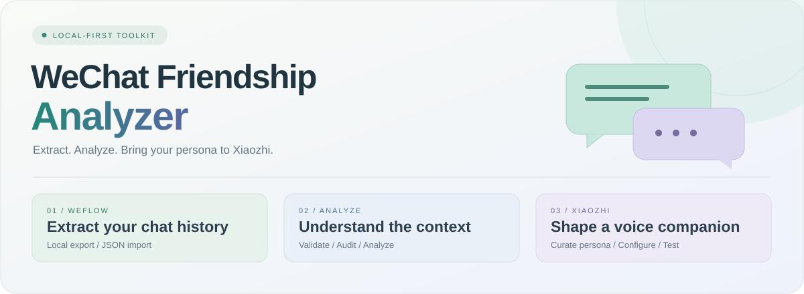

<p align="center">
  
</p>

<h1 align="center">微信会话数据整理与分析</h1>

<p align="center">从聊天记录出发，整理成小智可用的人格资料。<br><sub>Python 3.10+ · 本地数据工具 · 可复核交付</sub></p>

<p align="center">
  <a href="#功能导航"><strong>功能导航</strong></a> &nbsp; / &nbsp;
  <a href="#快速开始">快速开始</a> &nbsp; / &nbsp;
  <a href="docs/weflow-integration.md">WeFlow 接入</a> &nbsp; / &nbsp;
  <a href="xiaoyu/README.md">认识小鱼</a>
</p>

---

## 功能导航

<p align="center"><strong>① WeFlow 提取 → ② 整理与分析 → ③ 整合资料，接入小智</strong></p>

<table><tr>
<td width="33%" valign="top">
<h3>① 🔌 WeFlow 提取</h3>
<p>在本地取得指定好友的聊天数据，再将支持的原始 JSON 分页文件转为 JSONL。</p>
<p><sub>外部工具提取 · 本项目离线转换</sub></p>
<a href="docs/weflow-integration.md"><strong>从提取开始 →</strong></a>
</td>
<td width="33%" valign="top">
<h3>② 🗂️ 整理与分析</h3>
<p>先核对消息完整性，再结合上下文分析交流方式，区分事实与推测。</p>
<p><sub>校验 · 审计 · 上下文分析</sub></p>
<a href="docs/workflow.md"><strong>查看分析流程 →</strong></a>
</td>
<td width="33%" valign="top">
<h3>③ 🐟 整合并接入小智</h3>
<p>将抽象风格、独立人格与已确认背景整理为提示词，手动配置到小智云端。</p>
<p><sub>资料审核 · 角色配置 · 语音验证</sub></p>
<a href="xiaoyu/README.md"><strong>整合人物资料 →</strong></a>
</td>
</tr></table>

## 快速开始

实际使用先按 [WeFlow 接入说明](docs/weflow-integration.md) 在本地提取已授权的单个私聊，再保存本转换器支持的原始 API JSON 分页。提取由外部 WeFlow 完成，本仓库不会自动安装组件或读取数据库。

下面用 **4 条虚构消息**演练后续步骤，无需安装 WeFlow。在仓库根目录打开 PowerShell，使用 Python 3.10+：

**1. 接收 WeFlow 数据并转换**

```powershell
$inputFile = "examples/weflow_response.sample.json"
$messages = "private_data/weflow_demo.jsonl"
python -B -X utf8 scripts/import_weflow.py $inputFile `
  --expected-count 4 --output $messages
```

**2. 校验、审计，再分析**

```powershell
python -B -X utf8 scripts/validate_jsonl.py $messages --check-privacy
python -B -X utf8 scripts/audit_data.py $messages `
  --output private_reports/weflow_demo_audit.md
```

先复核总量、双方数量、系统事件和时间跨度，再按 [分析方法](docs/analysis-methodology.md) 与 [分析提示词](templates/analysis_prompt.md) 开展上下文分析。统计报告不会自动生成关系结论。

**3. 整合资料，接入小智**

按 [完整工作流](docs/workflow.md) 提炼可复用风格，整合到 [小鱼提示词](xiaoyu/character/system_prompt.md)。确认不含第三方私人信息后，按 [小智配置指南](xiaoyu/README.md) 手动保存到云端，再测试语音表现。不要把原始聊天 ZIP 当作角色提示词上传。

<details>
<summary><strong>可选：生成本地分析交付包</strong></summary>

```powershell
python -B -X utf8 scripts/package_data.py private_data/weflow_demo.jsonl `
  --document docs/data-format.md --output personal_exports/weflow_demo.zip
```

再次运行请换新输出文件名。需要别名整理时可先运行 [anonymize_data.py](scripts/anonymize_data.py)；它不自动消除正文隐私。主会话与转发内嵌记录分别统计，已有独立转发文件可通过 `--forwarded` 附带。WeFlow 转换器本版不展开内嵌转发。

</details>

## 每一步，都有可检查的结果

| 顺序 | 产物 | 入口 |
| :--- | :--- | :--- |
| **01 · 提取与转换** | 本地原始响应、规范 JSONL | [WeFlow 接入](docs/weflow-integration.md) |
| **02 · 校验与审计** | 完整性检查、发送方与月度统计 | [校验](scripts/validate_jsonl.py) · [审计](scripts/audit_data.py) |
| **03 · 内容分析** | 有上下文依据的观察与不确定性 | [分析方法](docs/analysis-methodology.md) |
| **04 · 整合资料** | 独立人格、风格规则、已确认背景 | [小鱼资料](xiaoyu/README.md) |
| **05 · 接入与验证** | 云端角色配置、实际语音体验 | [配置步骤](xiaoyu/README.md#快速使用) |

## 小鱼，让对话留一点呼吸感

> **用户：** 我有点累，今天不弄了。<br>
> **小鱼：** 好，今天就到这儿。剩下的下次再看。

原创风格示例，不是真实聊天摘录。小鱼用短句接住话题，技术问题优先准确性，保持独立 AI 身份。

[人物设定](xiaoyu/character/character_profile.md) · [直接使用提示词](xiaoyu/character/system_prompt.md) · [交流风格](xiaoyu/character/conversation_style.md) · [记忆设计](xiaoyu/memory/memory_rules.md)

## 文档书架

| 数据与工作流 | 分析与表达 | 接入与边界 |
| :--- | :--- | :--- |
| [本地工作流](docs/workflow.md) | [分析方法](docs/analysis-methodology.md) | [WeFlow 接入](docs/weflow-integration.md) |
| [消息格式](docs/data-format.md) | [分析提示词](templates/analysis_prompt.md) | [小鱼使用指南](xiaoyu/README.md) |
| [JSON Schema](templates/message_schema.json) | [报告目录](reports/README.md) | [隐私约定](docs/privacy.md) |

## 当前进展

| 模块 | 已提供 | 待完成 |
| :--- | :--- | :--- |
| WeFlow | 离线转换器、虚构样例、测试 | 外部提取环境配置与真实端到端验证 |
| 数据工具 | 校验、审计、别名整理、打包 | 按实际数据复核结果 |
| 小鱼 | 三版提示词、互动风格、原创示例 | 按设备语音表现调整 |
| 自定义记忆 | JSON 空模板与接口设计 | 后端实现与接入 |

> [!NOTE]
> **私人数据留在本机。** 公开仓库只包含代码、通用资料和虚构示例，不包含真实聊天、个人记忆或云端备份。脚本不自动上传聊天；正文隐私仍需自行复核。WeFlow 上游许可与原生组件要求见接入说明。

---

<p align="center"><sub>保留原文 · 明确边界 · 让每一步可复核</sub></p>
