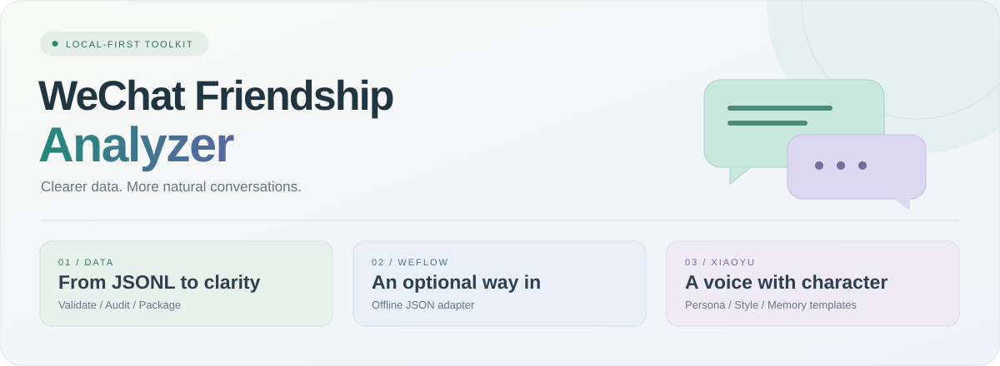

<p align="center">
  
</p>

<h1 align="center">微信会话数据整理与分析</h1>

<p align="center">让聊天数据有条理，让 AI 交流更自然。<br><sub>Python 3.10+ · 本地数据工具 · 可复核交付</sub></p>

<p align="center">
  <a href="#功能导航"><strong>功能导航</strong></a> &nbsp; / &nbsp;
  <a href="#快速开始">快速开始</a> &nbsp; / &nbsp;
  <a href="docs/weflow-integration.md">WeFlow 接入</a> &nbsp; / &nbsp;
  <a href="xiaoyu/README.md">认识小鱼</a>
</p>

---

## 功能导航

<table>
<tr>
<td width="33%" valign="top">
<h3>🗂️ 数据整理</h3>
<p>把已授权取得的聊天记录，整理成可校验、可审计的数据包。</p>
<p><sub>JSONL · 月度统计 · SHA-256</sub></p>
<a href="docs/workflow.md"><strong>开始整理 →</strong></a>
</td>
<td width="33%" valign="top">
<h3>🔌 WeFlow 接入</h3>
<p>转换单个私聊的原始 API JSON 分页文件，衔接现有分析流程。</p>
<p><sub>离线适配 · 不自动读取数据库</sub></p>
<a href="docs/weflow-integration.md"><strong>查看接入方法 →</strong></a>
</td>
<td width="33%" valign="top">
<h3>🐟 小鱼 Xiaoyu</h3>
<p>自然接话、适当幽默、愿意倾听，也能认真帮助你排查技术问题。</p>
<p><sub>三版提示词 · 原创示例 · 记忆模板</sub></p>
<a href="xiaoyu/README.md"><strong>打开人物资料 →</strong></a>
</td>
</tr>
</table>

## 快速开始

在仓库根目录打开 PowerShell，使用 **Python 3.10+**。脚本仅依赖标准库；下面的对话数据均为虚构。

**1. 校验样例并生成审计报告**

```powershell
$sample = "examples/sample_messages.jsonl"
python -B -X utf8 scripts/validate_jsonl.py $sample --check-privacy
python -B -X utf8 scripts/audit_data.py $sample `
  --output private_reports/demo_audit.md
```

**你会得到：** 消息数量、双方发送统计、月度分布和数据问题报告。

<details>
<summary><strong>下一步：整理发送者标签并生成 ZIP</strong></summary>

**2. 整理发送者标签并打包**

```powershell
$sample = "examples/sample_messages.jsonl"
$checked = "private_data/demo_checked.jsonl"
python -B -X utf8 scripts/anonymize_data.py $sample `
  --alias "示例用户A=user_a" --alias "示例用户B=user_b" `
  --output $checked
python -B -X utf8 scripts/package_data.py $checked `
  --document docs/data-format.md --output personal_exports/demo.zip
```

报告和 ZIP 分别写入 `private_reports/` 与 `personal_exports/`。再次运行时请使用新的输出文件名。处理真实会话时，按时间顺序传入多个主会话 JSONL，合并转发内嵌记录可通过 `--forwarded` 单独附带。

</details>

<details>
<summary><strong>试试 WeFlow：转换 4 条虚构消息</strong></summary>

```powershell
$inputFile = "examples/weflow_response.sample.json"
python -B -X utf8 scripts/import_weflow.py $inputFile `
  --expected-count 4 --output private_data/weflow_demo.jsonl
```

无需安装 WeFlow 即可运行此样例。真实数据的分页规则和支持范围见 [接入说明](docs/weflow-integration.md)。再次运行请换新输出文件名。

</details>

## 每一步，都有可检查的结果

| 阶段 | 你会得到 | 工具 |
| :--- | :--- | :--- |
| **01 · 接入** | 将 WeFlow 原始 JSON 统一为 JSONL | [import_weflow.py](scripts/import_weflow.py) |
| **02 · 校验** | 字段、顺序、重复和可选隐私模式检查 | [validate_jsonl.py](scripts/validate_jsonl.py) |
| **03 · 审计** | 发送方、月份、消息类型与附件统计 | [audit_data.py](scripts/audit_data.py) |
| **04 · 整理** | 应用显式别名，保留正文与引用 | [anonymize_data.py](scripts/anonymize_data.py) |
| **05 · 交付** | ZIP、试解压和 SHA-256 校验 | [package_data.py](scripts/package_data.py) |

## 小鱼，让对话留一点呼吸感

> **用户：** 我有点累，今天不弄了。<br>
> **小鱼：** 好，今天就到这儿。剩下的下次再看。

原创风格示例，不是真实聊天摘录。小鱼用短句接住话题，技术问题优先准确性，保持独立 AI 身份。

[人物设定](xiaoyu/character/character_profile.md) · [直接使用提示词](xiaoyu/character/system_prompt.md) · [交流风格](xiaoyu/character/conversation_style.md) · [记忆设计](xiaoyu/memory/memory_rules.md)

## 文档书架

| 数据与工作流 | 分析与表达 | 接入与边界 |
| :--- | :--- | :--- |
| [本地工作流](docs/workflow.md) | [分析方法](docs/analysis-methodology.md) | [WeFlow 接入](docs/weflow-integration.md) |
| [消息格式](docs/data-format.md) | [分析提示词](templates/analysis_prompt.md) | [小鱼使用指南](xiaoyu/README.md) |
| [JSON Schema](templates/message_schema.json) | [报告目录](reports/README.md) | [隐私约定](docs/privacy.md) |

## 当前进展

| 模块 | 已提供 | 待完成 |
| :--- | :--- | :--- |
| 数据工具 | 校验、审计、别名整理、打包 | 按实际数据复核结果 |
| WeFlow | 离线转换器、虚构样例、测试 | 真实环境端到端验证 |
| 小鱼 | 三版提示词、互动风格、原创示例 | 按设备语音表现调整 |
| 自定义记忆 | JSON 空模板与接口设计 | 后端实现与接入 |

> [!NOTE]
> **私人数据留在本机。** 公开仓库只包含代码、通用资料和虚构示例，不包含真实聊天、个人记忆或云端备份。脚本不自动上传聊天；正文隐私仍需自行复核。WeFlow 上游许可与原生组件要求见接入说明。

---

<p align="center"><sub>保留原文 · 明确边界 · 让每一步可复核</sub></p>
